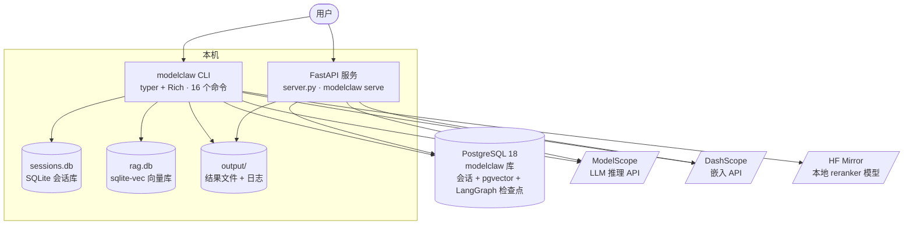
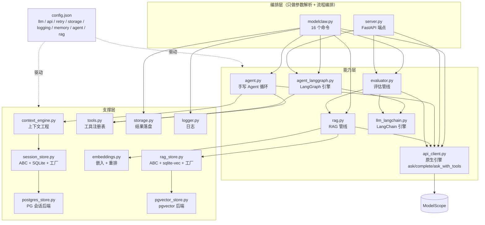
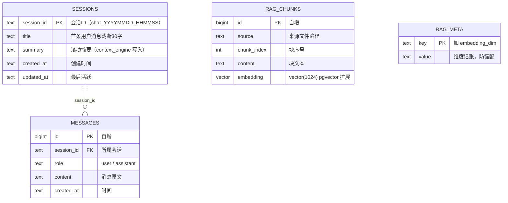
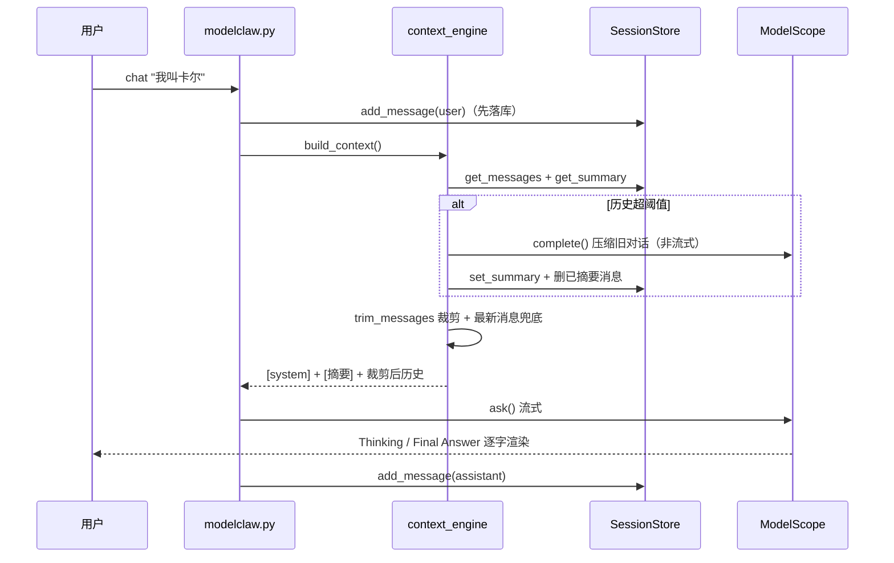
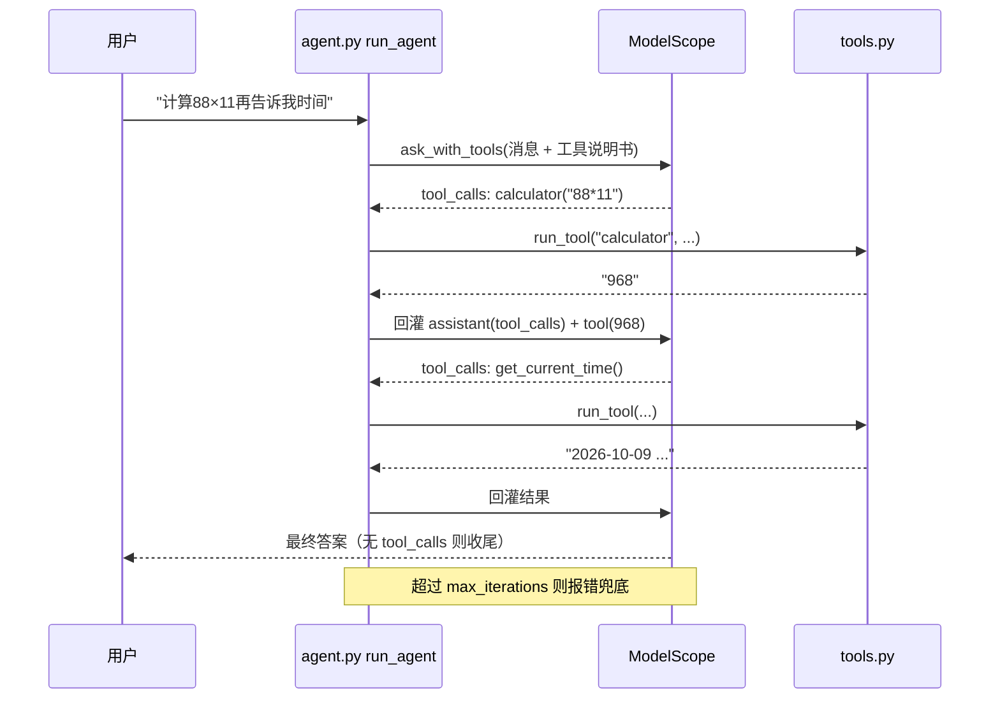
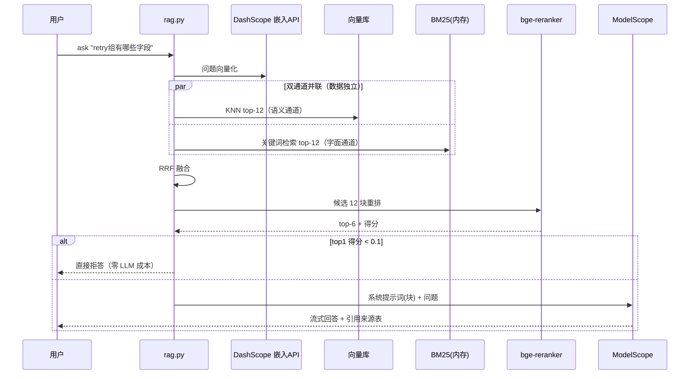
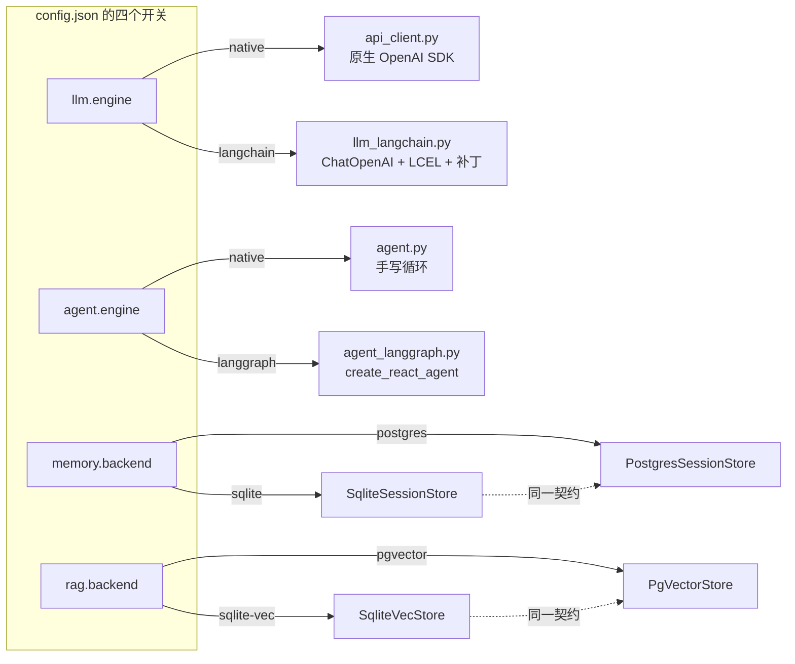
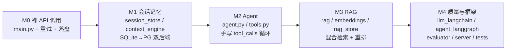

# modelclaw 架构图（架构多视图）

> 复盘用学习地图：六张图从宏观到细节覆盖整个项目。
> 全部 Mermaid 编写（Diagram as Code），GitHub / VS Code 原生渲染。
> 每张图附「读图指南」：怎么看 + 对应哪些代码文件。

---

## 图 1 · 系统上下文图（这个项目活在什么世界里）

**读图指南**：系统有两个入口（CLI / HTTP），三个云端依赖（LLM、嵌入、模型镜像），存储四处分布（PG、两个本地 SQLite 文件、output/ 目录）。PG 一个库同时承载三类数据：会话、向量、LangGraph 检查点。
**对应文件**：`modelclaw.py`（CLI）、`server.py`（HTTP）、`config.json`（所有连接参数）。

---

## 图 2 · 模块依赖图（代码怎么分层）

**读图指南**：三层结构——编排层不碰业务，能力层不碰存储细节，支撑层不知道谁调用它。注意箭头方向：`modelclaw.py` 指向一切，但没有任何模块指回它。配置从右侧「驱动」所有层（虚线）。
**对应文件**：图里的每个节点就是同名 .py 文件。

---

## 图 3 · 数据库 ERD（表关系全图，已与真实 schema 核对）

上图是 **PostgreSQL（modelclaw 库）**。本地 SQLite 是同构设计：

| SQLite 文件 | 表 | 与 PG 的差异 |
|---|---|---|
| `output/sessions.db` | `sessions` + `messages` | 结构完全一致（自增列类型不同：INTEGER vs BIGINT） |
| `output/rag.db` | `chunks` + `vec_chunks`（虚表）+ `rag_meta` | sqlite-vec 双表设计：向量在虚表，靠 rowid 关联 chunks.id |

LangGraph 引擎启用后，PG 里还会出现官方 checkpointer 的 4 张表：`checkpoints` / `checkpoint_blobs` / `checkpoint_writes` / `checkpoint_migrations`（框架自管，应用代码不直接读写）。

**读图指南**：一对多关系只有一条——会话拥有消息。RAG 侧没有外键：向量是可从源文档重建的派生数据。`rag_meta` 是 M3.5 修的「维度硬编码」缺口的产物。
**对应文件**：`session_store.py` / `postgres_store.py` / `rag_store.py` / `pgvector_store.py`（各文件顶部的 SCHEMA 常量）。

---

## 图 4 · 核心序列图（三条主链路）

### 4a. chat 一轮（会话记忆 + 上下文工程）

### 4b. agent 一轮（工具调用循环）

### 4c. ask 一轮（RAG 三级检索管线）

**读图指南**：三条链路共享同一个 LLM 但用法不同——chat 走流式、agent 走工具协议、ask 走检索增强。注意 4c 的「并联」是两个检索通道数据独立（M3 学习里掰扯过的那点）。
**对应文件**：`modelclaw.py` / `agent.py` / `rag.py` / `context_engine.py`。

---

## 图 5 · 可插拔结构图（四个配置开关 × 双实现）

**读图指南**：四个开关各自独立、可任意组合。每个开关背后的两个实现都满足同一份接口契约（SessionStore / RagStore 的 ABC），`tests/` 里的契约测试就是证明。这是 Repository 模式贯穿 M1.5 → M3.5 → M4 的三次实践。
**对应文件**：`session_store.py` / `rag_store.py` 底部的工厂函数；`api_client.ask()` 与 `modelclaw.py agent` 命令里的引擎分发。

---

## 图 6 · 演进路线图（这个项目怎么长出来的）

**读图指南**：每个里程碑新增一组模块，但从不推翻前一层——记忆给 Agent 用、检索给评估用、契约测试保护重构。「从零重建」的秘诀就在这条路径里：按 M0→M4 的顺序，每个阶段只加一层。
**对应文件**：`doc/M1学习计划.md` ~ `doc/M4学习计划.md`（每阶段的学习笔记与验收清单）。

---

## 使用建议

- **快速回忆**：先看图 6 定位阶段 → 图 2 定位模块 → 图 4 看数据流 → 图 3 查表结构
- **向别人讲解**：图 1 开场 → 图 5 展示架构功力（可插拔）→ 图 4c 讲 RAG 细节
- **从零重建**：图 6 的顺序 + 各阶段学习计划的验收清单
